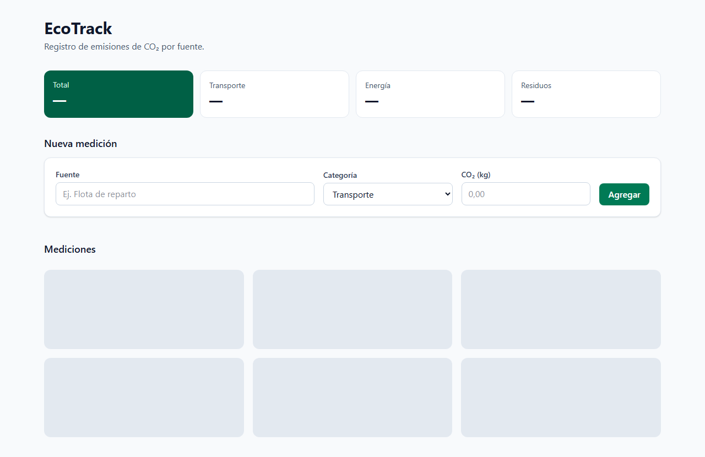
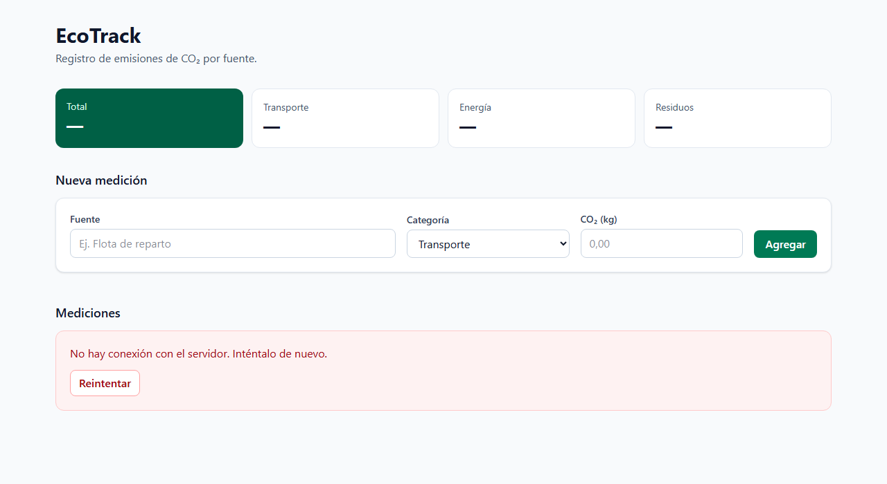
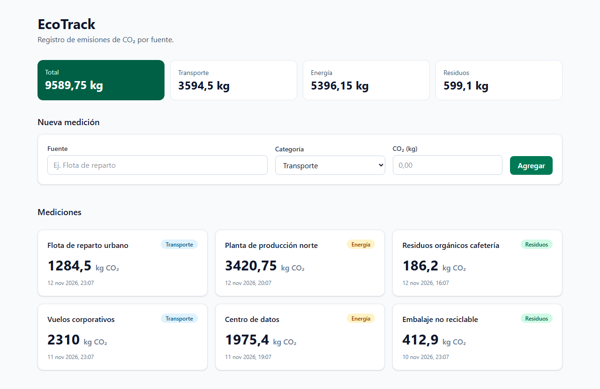
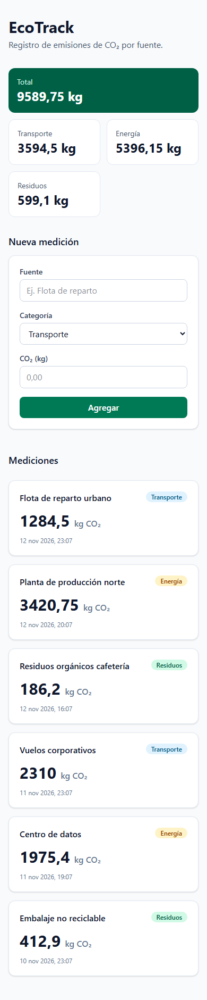

# Bitácora de entrega — EcoTrack Dashboard

**Stack:** React 18.3 · TypeScript (`strict: true`) · Vite 8 · Tailwind CSS 4 · Supabase JS 2 (tabla `public.emissions`).
**Repositorio:** https://github.com/DiegoFernandoChavarroCastillo/ecotrack-dashboard

---

## 1. Ciclo Spec-to-Code

Cuatro iteraciones, un commit cada una. Los prompts son los textos de cada etapa tal como se le entregaron al asistente.

### Iteración 1 — Estructura · `5c29d2e`

```text
ITERACIÓN 1 — Estructura (commit "feat: estructura y tipos (prompt 1)")
Define el árbol de archivos (máx. 3 niveles), la responsabilidad de cada uno en una línea
y las interfaces TypeScript de props y del retorno del hook. Crea los archivos con esas
firmas, aún sin implementar la lógica.
```

**Qué cambió:** se fija la arquitectura antes que la lógica: `lib/` (cliente), `types/` (contratos), `hooks/` (datos) y `components/` (UI). `UseEmissionsResult` y las props quedan tipadas desde el inicio, y el hook es un stub que compila, así que el contrato existe antes que la implementación.

Commit inicial, sin anterior con el que comparar: https://github.com/DiegoFernandoChavarroCastillo/ecotrack-dashboard/commit/5c29d2e

### Iteración 2 — Lógica · `db224a8`

```text
ITERACIÓN 2 — Lógica (commit "feat: hook useEmissions con loading y error (prompt 2)")
Implementa lib/supabase.ts y useEmissions.ts: estados loading, error y data; carga
inicial en useEffect; addEmission que inserta y refresca; errores de Supabase traducidos
a mensajes en español, nunca el objeto crudo. Añade una UI mínima que ya funcione.
```

**Qué cambió:** el stub pasa a tener comportamiento. El cliente falla pronto si faltan variables de entorno, y el hook carga en `useEffect`, inserta y vuelve a consultar. Se añade `lib/errors.ts`, que convierte `PostgrestError` en mensajes en español por código. Queda una deuda: los datos llegan sin tipo y se fuerzan con `as Emission[]`.

https://github.com/DiegoFernandoChavarroCastillo/ecotrack-dashboard/compare/5c29d2e...db224a8

### Iteración 3 — Refinamiento · `f4d25c3`

```text
ITERACIÓN 3 — Refinamiento (commit "refactor: TS estricto, accesibilidad y memo (prompt 3)")
- TypeScript estricto: cero any, discriminated union para el estado de la petición,
  tipos derivados del esquema de la tabla.
- Accesibilidad: cada input con <label> asociado, aria-live="polite" en los mensajes,
  aria-busy durante la carga, foco visible y operable por teclado.
- Rendimiento: useMemo para el total de CO2 y el agrupado por categoría, useCallback en
  los handlers, key estable en la lista.
- Tailwind: grid de 1 columna en móvil, 2 en tablet y 3 en escritorio; skeleton de carga,
  estado vacío, mensaje de error visible y botón deshabilitado mientras guarda.
```

**Qué cambió:**
- **Tipos:** desaparece el cast. `types/database.ts` modela el esquema y `createClient<Database>` infiere las filas.
- **Estado:** los tres `useState` sueltos (`loading`/`error`/`data`), que permitían combinaciones imposibles, se sustituyen por `RequestState<T>`.
- **Interfaz:** se añaden labels, regiones `aria-live`, `aria-busy`, memorización y el grid responsive.

https://github.com/DiegoFernandoChavarroCastillo/ecotrack-dashboard/compare/db224a8...f4d25c3

### Iteración 4 — Corrección de un fallo real · `3bcf172`

```text
ITERACIÓN 4 — Corrección de un fallo real (commit "fix: ... (prompt 4)")
Ejecuta `npm run build` y revisa el código en busca de un defecto auténtico de
concurrencia o de estado: doble envío al hacer clic dos veces, formulario que no se
limpia, error anterior que persiste al reintentar, o setState después de desmontar.
Corrígelo DENTRO del hook, no en el componente, y añade actualización optimista que
revierta la lista si el insert falla. Documenta cuál era el fallo y por qué ocurría.
```

**Fallo detectado:** en `f4d25c3`, `reload()` hacía `setList` con cualquier respuesta que llegara, sin comprobar si seguía siendo la más reciente. El escenario es este:
1. La carga inicial va lenta.
2. El usuario guarda una medición.
3. El insert y su `reload()` terminan antes que la carga inicial.
4. Llega la respuesta de la carga inicial, con datos anteriores al insert, y **sobrescribe la lista**: la fila nueva desaparece y el total queda mal.

**Por qué ocurría:** las promesas no se resuelven en el orden en que se lanzan y el último `setList` gana. La misma revisión encontró tres defectos más:
- **Doble envío:** solo lo frenaba `disabled`, que depende de un re-render, así que dos llamadas en el mismo tick insertaban dos filas.
- **Error persistente:** `reload()` no salía del estado `error` al reintentar.
- **setState tras desmontar:** se escribía estado después del unmount.

**Corrección, solo en `useEmissions.ts`:**
- Contador `latestRequest`: solo escribe la petición más reciente.
- `mounted` descarta las respuestas que llegan tras desmontar.
- `inFlight` es un ref síncrono que bloquea el doble envío.
- `reload` vuelve a `loading` antes de reintentar.
- Inserción optimista con id temporal: si falla, se quita solo esa fila, en vez de restaurar una copia que pisaría cambios concurrentes.

El fallo se detectó revisando el código, no reproduciéndolo contra una base real.

https://github.com/DiegoFernandoChavarroCastillo/ecotrack-dashboard/compare/f4d25c3...3bcf172

---

## 2. Ejecución técnica

**Separación lógica/UI.** Ningún componente importa `supabase`; el hook es la única frontera con los datos (`src/types/emissions.ts:23-28`):

```ts
export interface UseEmissionsResult {
  list: RequestState<Emission[]>
  submit: RequestState<Emission>
  addEmission: (input: NewEmission) => Promise<boolean>
  reload: () => Promise<void>
}
```

`EmissionsTracker.tsx:14` solo consume: `const { list, submit, addEmission, reload } = useEmissions()`.

**TypeScript estricto.** Unión discriminada (`src/types/emissions.ts:17-21`). El estado `success` es el único que tiene `data`, así que el compilador impide leer datos durante `loading`:

```ts
export type RequestState<T> =
  | { status: 'idle' }
  | { status: 'loading' }
  | { status: 'success'; data: T }
  | { status: 'error'; error: string }
```

`Emission` se deriva de `Database['public']['Tables']['emissions']['Row']`. El comando `grep -rn ": any\|as any" src/` no devuelve ninguna coincidencia (código de salida 1) y `npm run build` (`tsc -b && vite build`) pasa sin errores.

**Manejo asíncrono.**
- **Carga y orden** (`useEmissions.ts:21-26`): la respuesta solo se aplica si sigue siendo la última petición.
- **Errores** (`lib/errors.ts:14-17`): se traducen por código (`23502`, `22P02`, `42501`…), con un mensaje genérico de reserva.
- **Doble envío y rollback** (`useEmissions.ts:50-67`):

```ts
if (inFlight.current) return false
inFlight.current = true
setList((prev) => (prev.status === 'success' ? { ...prev, data: [optimistic, ...prev.data] } : prev))
const { data, error } = await supabase.from('emissions').insert(input).select().single()
// si error:
setList((prev) => prev.status === 'success' ? { ...prev, data: prev.data.filter((e) => e.id !== tempId) } : prev)
```

---

## 3. Calidad de UI

**Grid responsive** (`EmissionsTracker.tsx:10`): `grid grid-cols-1 gap-4 sm:grid-cols-2 lg:grid-cols-3`. Es 1 columna en móvil, 2 desde 640 px y 3 desde 1024 px. El formulario usa `sm:grid-cols-2 lg:grid-cols-[2fr_1fr_1fr_auto]`.

**Estado deshabilitado** (`EmissionForm.tsx:94-95`): `disabled={submitting}` con `disabled:cursor-not-allowed disabled:opacity-60`. Mientras guarda, el texto cambia a «Guardando…».

**Feedback:**
- **Carga:** skeleton de 6 bloques `h-36 animate-pulse rounded-xl bg-slate-200` con `aria-hidden`, más un texto «Cargando mediciones…» solo para lectores de pantalla.
- **Vacío:** «Aún no hay mediciones…» con borde punteado.
- **Error:** caja roja con el mensaje traducido y el botón «Reintentar».
- **Guardado:** confirmación «Medición «…» guardada».

**Accesibilidad:**
- `<label htmlFor>` con ids de `useId` en los tres campos (`EmissionForm.tsx:50, 64, 76`).
- `aria-live="polite"` en la validación y en los mensajes de guardado y de lista (`EmissionsTracker.tsx:56, 72`).
- `aria-busy={isLoading}` en el resumen y en la lista (`EmissionsTracker.tsx:33, 68`).
- `focus-visible:ring-2` en campos y botones; todos son elementos nativos, así que se manejan con teclado.






---

## 4. Tabla de cumplimiento

| Criterio | Evidencia verificable |
|---|---|
| Prompteo iterativo | Cuatro commits en orden: `5c29d2e` → `db224a8` → `f4d25c3` → `3bcf172`, con un prompt por commit. Diffs en `compare/5c29d2e...db224a8`, `compare/db224a8...f4d25c3` y `compare/f4d25c3...3bcf172`. La iteración 4 corrige un fallo concreto de la 3: la respuesta obsoleta (`useEmissions.ts:10-11, 26`). |
| Ejecución técnica React+Supabase | Cliente tipado en `lib/supabase.ts:11`, contrato del hook en `types/emissions.ts:23-28`, unión discriminada en `types/emissions.ts:17-21`, traducción de errores en `lib/errors.ts:14-17` y concurrencia y rollback en `hooks/useEmissions.ts:21-26, 50-67`. El build pasa y no hay ningún `any`. |
| Calidad de UI y usabilidad | Grid en `EmissionsTracker.tsx:10`, skeleton en `:93-95`, estado vacío en `:88`, «Reintentar» en `:82`, `aria-busy` en `:33, 68`, `aria-live` en `:56, 72`, labels en `EmissionForm.tsx:50, 64, 76` y botón deshabilitado en `:94-95`. Capturas en `docs/`. |
